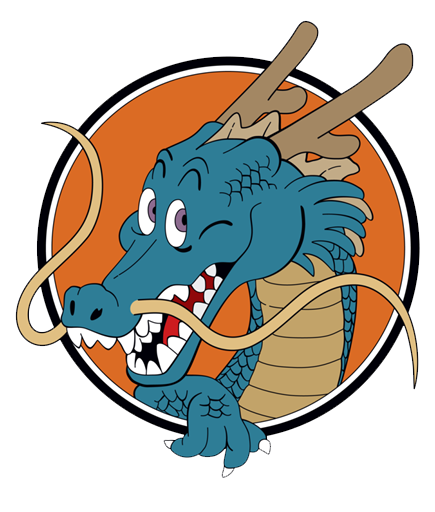

# Autolearn

A standalone Mudlet package for CKMud that masters all your skills, and learns
new skills once you have mastered their prerequisites. Extracted from the
[CK](https://github.com/CKMud-Mudlet-Scripts/CK) package and fully
self-contained - it does NOT require CK to be installed.

## Installation

`lua installPackage("https://github.com/brumouta/ckmud-mudlet-packages/releases/latest/download/Autolearn.mpackage")`

**Requires the [MSDP](../MSDP) package**, which supplies the stats this package reads. Install it first.

After installation, `al update` updates it.

You must turn on `msdp` in settings to use this script (the package enforces
the correct protocol settings on connect, same as CK does). Also while you are
there disable MSSP and GMCP.

## Usage

Set it up once (it's saved), then start and stop it:

```
al target elder          what to train on
al path n;n;n;n;w        the walk from the target to your rest spot (an isolation tank)
al recall crecall;w      optional: reach the tank from any room instead of walking the path
al setup                 check what's set and what's missing
al start                 start learning
al stop                  stop
```

`al start elder n;n;n;n;w` sets and saves both in one go. Androids rest where they are, so they
don't need a path. `al status` says whether it's learning, on what, and how many skills are left.
`AL` and `autolearn` work as well as `al`, and the old `autolearn <target> <path>` still starts it
(and saves them); a bare `autolearn` turns it on or off.

**The way back comes from the path:** `crecall`, then the path backwards with every step
reversed. `al path n;n;n;n;w` walks back with `crecall;e;s;s;s;s` (`al setup` shows it). It's used
after resting, after training portal/instant transmission (they teleport you to king kai), and
when the target isn't there. A path with a step that isn't a direction (`enter vort`) can't be
walked back, so then portal/instant aren't trained.

The path takes `;`, commas, spaces or counts (`n;n;n;n;w`, `n n n n w`, `4n w`). Type it with a
single `;`: Mudlet splits what you type at `;;` before the alias sees it.

To rest, the bot walks the path to the tank and back. With `al recall` set (mine is `crecall;w`)
it recalls to the tank from wherever it is instead.

The bot needs to know your skills and race: it sends `learn` and `score` when
it sees the MOTD, and again when you toggle `autolearn` on. If your race shows
as `???`, type `score` once.

### What it trains first

By default ki attacks come first, then fatigue attacks, AoE, buffs, heals, ultras, then the
other skills (powersense, multiform, scan, instant, ...). Whatever you can't afford right now
waits while the others train. To train some skills first, list them in order:

`al priority multiform, kamehameha, roundhouse` (`al priority` shows the list, `al priority clear` empties it)

Names are the ones `learn` shows (or the short command, `kame`). Spaces don't matter (`power up` = `powerup`).
When you set it, each name is checked against your skills and any that isn't one is
reported, with the closest match (`Not one of your skills: 'multifrom' - did you mean 'multiform'?`). A priority skill you can't
afford yet waits, and the others keep training meanwhile.

Multiform is trained with `focus 'multiform'` followed by `order followers dismiss`, so no
clones pile up (that also dismisses any other followers you have).

### Pausing for Gumshoe's repeat

With Gumshoe's `gum repeat` on (`gumshoe.xml`), learning steps aside for every case: just before
Gumshoe heads to Jaco it pauses, lets a fight end and wakes you if you're resting. Once Gumshoe is
back at Jaco after the case, learning starts again and gets back the way resting does: the
`al recall` recall, a rest, then your path back to the target, instead of the `gum repeat wait`
commands. For that it needs `al recall` and `al path` set; without them it stays off after the
case and says so. `al stop` while it's paused keeps it off. `al gumshoe off` turns this off.

## Commands

| Command | What it does |
|---|---|
| `al` / `al help` | The commands |
| `al setup` | What's set and what's missing |
| `al target <mob>` | What to train on (saved) |
| `al path <steps>` | From the target to your rest spot (saved; `al path clear` empties it) |
| `al recall <commands>\|off` | Reach the rest spot from any room (saved) |
| `al start [target [path]]` | Start learning, with the saved setup or what's given (saved too) |
| `al stop` | Stop learning |
| `al status` | Learning or not, on what, how many skills left |
| `al priority [skills\|clear]` | Skills to train first, in order |
| `al gumshoe on\|off` | Pause for Gumshoe's `gum repeat` cases (default on) |
| `al features` / `al feature <name> on\|off` | Every feature switch |
| `al constants [prefix]` / `al constant <name> = <value>` | Every setting (these survive resetProfile()) |
| `al update` | Update Autolearn to the latest release |

## Running alongside CK

Autolearn keeps all of its state under its own `AL` global namespace, its own
`Autolearn` settings database, and its own `AL.*` events, so it will not
corrupt an installed CK package. If you do run both, note that each package
parses the prompt and MOTD independently (you may see doubled login commands),
and you should use CK's own `autolearn` OR this package - not both at once.
Recent CK versions no longer ship the autolearn feature.

## Development

This is a [muddler](https://github.com/demonnic/muddler) project - run `muddler`
in this directory to produce `build/Autolearn.mpackage`.

Before building, two checks catch the common failure modes:

```
python3 ../../tools/lint_manifests.py src   # every trigger/alias has a script
cd tests && npm install && node runner.js driver.lua   # simulated Mudlet run
```

The tests run the real package sources in a Lua VM with a stubbed Mudlet API
and simulate connect -> MSDP feed -> score/learn parsing -> prompt ->
`autolearn` toggle -> bot attack/rest/wake cycle.
