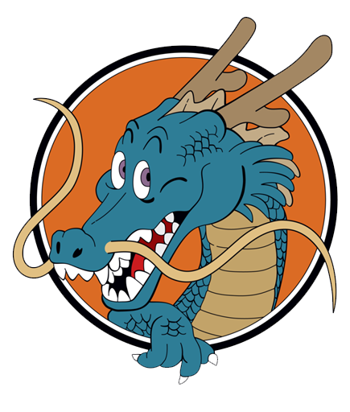

# KaiokenTrain

A standalone Mudlet package for CKMud that trains your kaioken to the maximum
mastery level: it raises kaioken step by step, drinks when thirsty, rests when
fatigued, and stops when kaioken is mastered. Extracted from the
[CK](https://github.com/CKMud-Mudlet-Scripts/CK) package and fully
self-contained — it does NOT require CK to be installed.

## Installation

`lua installPackage("https://github.com/brumouta/ckmud-mudlet-packages/releases/latest/download/KaiokenTrain.mpackage")`

After installation the `KT update` alias will take care of updating the script.

You must turn on `msdp` in settings to use this script (the package enforces
the correct protocol settings on connect, same as CK does). Also while you are
there disable MSSP and GMCP.

## Usage

`kaioken train` - toggle kaioken auto training. Try to hang out in an
isolation chamber, and keep a drink source in your inventory (it sends
`drink tears` by default - change it with e.g.
`KT constant kaioken.drink_cmd="drink flask"`). Run it again to
turn it off.

## Aliases

`kaioken train` - toggle kaioken auto training

`KT` - get a list of KaiokenTrain commands

`KT features` - list feature flags

`KT feature <name> <on|off>` - turn a feature on/off

`KT constants` - list script constants (these survive resetProfile())

`KT constant <name>=<value>` - set a script constant

`KT update` - update KaiokenTrain from github latest

## Running alongside CK or Autolearn

KaiokenTrain keeps all of its state under its own `KT` global namespace, its
own `KaiokenTrain` settings database, and its own `KT.*` events, so it will
not corrupt an installed CK or Autolearn package. Since each package has its
own mode system they are no longer mutually exclusive — run one bot at a
time. Recent CK versions no longer ship the kaioken train feature.

## Development

This is a [muddler](https://github.com/demonnic/muddler) project — run `muddler`
in this directory to produce `build/KaiokenTrain.mpackage`.

Before building, two checks catch the common failure modes:

```
python3 ../../tools/lint_manifests.py src   # every trigger/alias has a script
cd tests && npm install && node runner.js driver.lua   # simulated Mudlet run
```

The tests run the real package sources in a Lua VM with a stubbed Mudlet API
and simulate connect → MSDP feed → prompt/kaioken parsing → `kaioken train`
toggle → raise / drink / rest / wake / completion.
